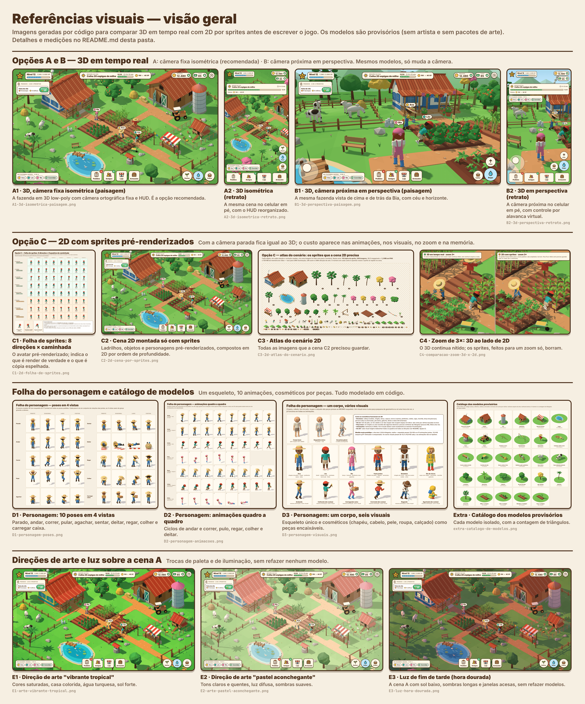
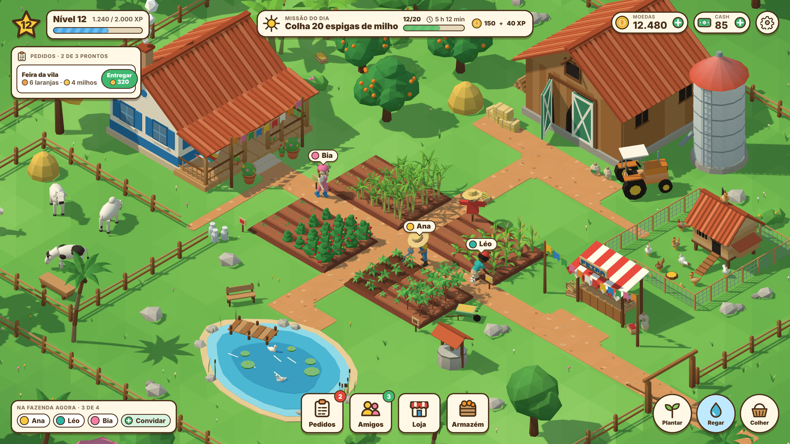
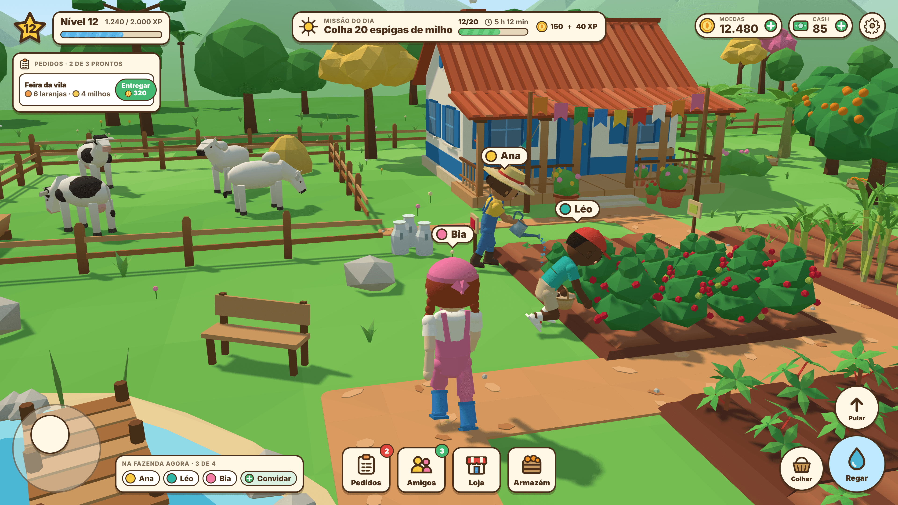
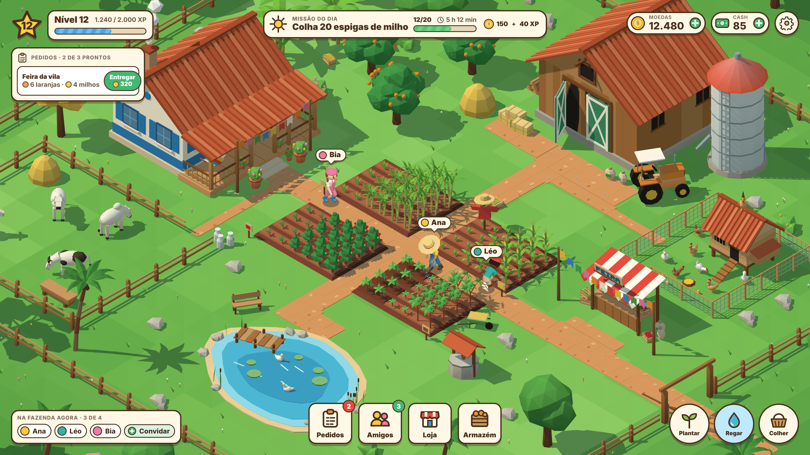
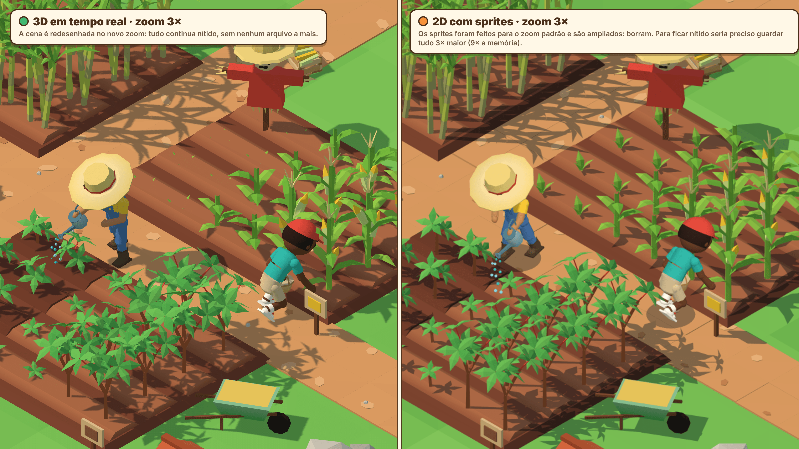
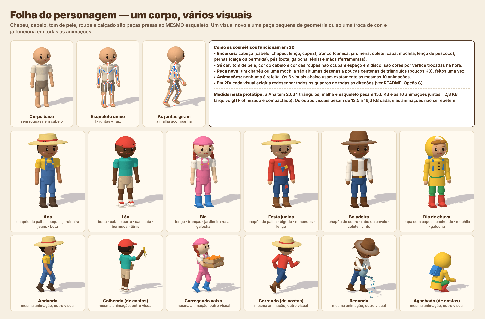

# Referências visuais: 3D em tempo real ou 2D por sprites?

Estas imagens existem para responder, olhando, a uma dúvida antes de escrever o jogo: vale fazer personagens e cenário em **3D de verdade**, ou sai mais barato um **"2D que parece 3D"**, com folhas de sprites em várias poses e ângulos?

A recomendação de trabalho que elas põem à prova é: **3D de verdade, low-poly estilizado, com câmera fixa em estilo isométrico e um personagem modular sobre um único esqueleto.**

Comece pela visão geral e depois abra as imagens em tamanho cheio (todas estão em 2×, feitas para dar zoom).



## O que as imagens mostram, em poucas linhas

1. **Com a câmera parada, o 2D por sprites fica igual ao 3D.** Compare `A1` com `C2`: é a mesma fazenda, e quase não dá para distinguir. A aparência, portanto, não decide a questão.
2. **O 2D "que parece 3D" não dispensa o 3D.** Para os sprites saírem assim foi preciso modelar e animar o personagem em 3D e depois fotografá-lo de cada ângulo. Sem o modelo 3D, a alternativa é desenhar à mão 340 quadros por visual (ver medições).
3. **O custo do 2D está na multiplicação.** Cada animação nova vale para 5 a 8 direções, e cada roupa ou chapéu repete tudo. Em 3D, a animação é feita uma vez e serve para qualquer visual e qualquer ângulo.
4. **O 2D prende a câmera, o zoom e a luz.** `C4` mostra o zoom; `E1`, `E2` e `E3` mostram três aparências que em 3D são trocas de paleta e de luz, e em 2D seriam três jogos de sprites.
5. **O peso do download não é o problema do 2D neste estilo.** Com cores chapadas, o PNG compacta muito bem. O que pesa é a memória de vídeo e a quantidade de conteúdo a produzir.

O que estas imagens **não** provam: desempenho em celular. Tudo foi renderizado por software, sem placa de vídeo, então não há medida de quadros por segundo. As contagens de triângulos e de draw calls abaixo servem de orçamento, e o teste em aparelho intermediário continua necessário.

## As imagens

Todas as cenas com HUD têm 1920×1080 (paisagem) ou 1080×1920 (retrato) em 2×, ou seja, 3840×2160 e 2160×3840 pixels.

### Opção A — 3D com câmera fixa isométrica (recomendada)

| Arquivo | Legenda |
|---|---|
| [`A1-3d-isometrica-paisagem.png`](A1-3d-isometrica-paisagem.png) | A fazenda inteira em 3D low-poly, câmera ortográfica fixa (isométrica verdadeira, 35,26° de elevação), com o HUD. Ana rega a mandioca, Léo colhe milho, Bia vem da casa pelo caminho. |
| [`A2-3d-isometrica-retrato.png`](A2-3d-isometrica-retrato.png) | A mesma cena com o celular em pé. A câmera aproxima e o HUD é reorganizado em faixas, com textos maiores. |



### Opção B — 3D com câmera próxima em perspectiva

| Arquivo | Legenda |
|---|---|
| [`B1-3d-perspectiva-paisagem.png`](B1-3d-perspectiva-paisagem.png) | A mesma fazenda, com a câmera acima e atrás da Bia. Aparecem o céu, os morros, o curral, a casa e os amigos trabalhando no café. O HUD ganha alavanca virtual e botões de ação. |
| [`B2-3d-perspectiva-retrato.png`](B2-3d-perspectiva-retrato.png) | A câmera próxima com o celular em pé. |



São os mesmos modelos da opção A; só a câmera muda. A opção B é mais envolvente, mas mostra os modelos de perto: exige arte e animação melhores, câmera que desvia de obstáculos e controle direto do personagem. A opção A perdoa mais, lê bem a fazenda inteira e combina com toque na tela e com retrato.

### Opção C — 2D com sprites pré-renderizados

| Arquivo | Legenda |
|---|---|
| [`C1-2d-folha-de-sprites.png`](C1-2d-folha-de-sprites.png) | O avatar renderizado do modelo 3D em 8 direções × 8 quadros de caminhada. As 5 linhas verdes são renders de verdade; as 3 laranjas são cópias espelhadas. No rodapé, o defeito do espelho: o regador troca de mão. |
| [`C2-2d-cena-por-sprites.png`](C2-2d-cena-por-sprites.png) | A fazenda montada só com imagens prontas: ladrilhos de chão, depois caminhos, canteiros e lagoa, depois as sombras, depois objetos e personagens em ordem de profundidade. |
| [`C3-2d-atlas-do-cenario.png`](C3-2d-atlas-do-cenario.png) | Todas as imagens que a cena C2 precisou guardar: 152 tipos de sprite, 249 imagens contando as sombras. |
| [`C4-comparacao-zoom-3d-x-2d.png`](C4-comparacao-zoom-3d-x-2d.png) | Zoom de 3× na mesma região: à esquerda o 3D redesenhado, nítido; à direita os sprites do zoom padrão ampliados, borrados. |



Diferenças reais entre `C2` e `A1`, para quem quiser procurar: a Ana está espelhada (regador na outra mão) e com luz mais chapada; as plantas de um mesmo tipo são todas idênticas, sem giro nem variação de tamanho; as árvores só têm dois tamanhos; os animais só olham em 8 direções; nenhuma sombra cai sobre outro objeto, só no chão.



### Folha do personagem

| Arquivo | Legenda |
|---|---|
| [`D1-personagem-poses.png`](D1-personagem-poses.png) | As 10 poses pedidas (parado, andar, correr, pular, agachar, sentar, deitar, regar, colher, carregar caixa), cada uma de frente, em diagonal, de lado e de costas. |
| [`D2-personagem-animacoes.png`](D2-personagem-animacoes.png) | Animações quadro a quadro: caminhada (lado e diagonal), corrida, pulo, regar, colher e deitar. |
| [`D3-personagem-visuais.png`](D3-personagem-visuais.png) | O corpo base, o esqueleto de 17 juntas e seis visuais diferentes (chapéus, cabelos, cinco tons de pele, roupas, calçados), parados e em ação. |



### Direções de arte e luz sobre a cena A

| Arquivo | Legenda |
|---|---|
| [`E1-arte-vibrante-tropical.png`](E1-arte-vibrante-tropical.png) | "Vibrante tropical": cores saturadas, casa amarela com detalhes em turquesa, água turquesa, sol forte e sombras marcadas. |
| [`E2-arte-pastel-aconchegante.png`](E2-arte-pastel-aconchegante.png) | "Pastel aconchegante": tons claros e quentes, luz difusa, sombras suaves. |
| [`E3-luz-hora-dourada.png`](E3-luz-hora-dourada.png) | Hora dourada: a paleta da cena A com sol baixo e alaranjado, sombras longas arroxeadas e janelas acesas. |

Nenhum modelo foi refeito para estas três: E1 e E2 trocam a tabela de cores e a luz; E3 troca a luz, acende as janelas e recebe um véu de cor bem leve por cima da imagem (um degradê em CSS, o único efeito aplicado depois do render em todo o conjunto).

### Visão geral e extra

| Arquivo | Legenda |
|---|---|
| [`F-visao-geral.png`](F-visao-geral.png) | Folha de contato com miniaturas legendadas de todas as imagens. |
| [`extra-catalogo-de-modelos.png`](extra-catalogo-de-modelos.png) | Cada modelo provisório isolado, com a contagem de triângulos. |
| [`medidas.json`](medidas.json) | Os números brutos das medições desta página. |

## Como as imagens foram feitas

Tudo sai de um pequeno projeto Node em [`tools/visual-refs`](../../tools/visual-refs):

- **Three.js r187** (pacote `three` do registro npm) desenha as cenas. O código é empacotado com `esbuild` e roda dentro do **Chromium headless** que já estava instalado na máquina, controlado pelo Playwright. Não há placa de vídeo: o WebGL2 roda por software (ANGLE + SwiftShader). Nesta máquina ele funciona sem nenhuma opção; o script passa `--use-angle=swiftshader --enable-unsafe-swiftshader --ignore-gpu-blocklist` só para deixar isso explícito.
- **Qualidade:** `deviceScaleFactor` 2, antisserrilhamento MSAA 4× do WebGL, um sol com mapa de sombras de 4096 px e filtro suave, uma luz hemisférica que tinge as sombras. Sem pós-processamento (a única exceção é o véu de cor da imagem E3): o que aparece nas cenas 3D é o que um celular desenharia a cada quadro.
- **Modelos:** geometria procedural (caixas, cilindros, esferas, extrusões, tornos, folhas curvas) com **cores por vértice**, sem nenhuma textura e com um único material. As cores vêm de uma tabela central, por isso trocar a direção de arte é trocar a tabela.
- **Personagem:** humanoide articulado com hierarquia de juntas (quadril, coluna, peito, pescoço, cabeça, braço e antebraço, mão, coxa, perna, pé). Cada pose e cada quadro de animação é um conjunto de rotações dessas juntas. A malha é uma só por personagem, e as roupas são peças presas aos mesmos ossos.
- **Planta da fazenda:** uma lista única de objetos e posições alimenta a cena 3D (A, B, E) e a montagem 2D (C). Na opção C cada objeto é renderizado uma vez para uma imagem com transparência, mais uma imagem de sombra, e a cena é composta num canvas 2D.
- **HUD:** HTML e CSS por cima da cena. Os ícones são SVG escritos à mão no código.
- **Arquivos finais:** captura de tela em PNG, recomprimida sem perda com `sharp`.

Para gerar de novo:

```bash
cd tools/visual-refs
npm install            # three, esbuild, sharp, glTF-Transform e meshoptimizer, todos do registro npm
npm run measure        # refaz as medições (dist/medidas.json e a cópia nesta pasta)
npm run render         # refaz todas as imagens desta pasta
node scripts/shot.mjs cenaA teste.png --w=1920 --h=1080 --dpr=2 --opts='{"paleta":"pastel"}'   # uma imagem avulsa
```

O Playwright e o Chromium não são dependências do projeto: os scripts usam os que já existem na máquina.

## O que é provisório, com franqueza

**Todos os modelos são marcadores de posição feitos em código. Não houve artista e não foi usado nenhum pacote de arte, nem gratuito.** Nenhuma textura, nenhum modelo, nenhum ícone e nenhuma animação vieram de terceiros, e nada foi tirado de jogos existentes: construções, culturas, personagens, HUD e nomes são originais, sem marcas nem logotipos.

O que isso significa na prática:

- **A composição, a paleta, a luz e a leitura da cena já servem de referência.** É razoável julgar por elas se o jogo deve ter esta cara.
- **Os modelos individuais estão no nível "protótipo bem cuidado".** De longe (opção A) convencem; de perto (opção B e folhas do personagem) mostram o que são: formas simples encaixadas.

Defeitos que eu vejo e que não se resolvem com mais código:

- As vacas são toscas, com a cabeça em blocos. Galinhas e patos passam, mas não têm charme próprio.
- O personagem tem juntas rígidas: cotovelos e joelhos são esferas encaixadas, sem pele contínua. Mãos sem dedos. O rosto é simpático, mas genérico.
- As animações são fórmulas: a caminhada funciona, mas falta peso, antecipação e personalidade. O "deitar" com chapéu de aba atravessa o chão.
- A vegetação é geométrica demais: copas em bolhas facetadas, mandioca e cana finas.
- O chão é totalmente plano e a água é um polígono azul, sem movimento nem reflexo.
- Não há partículas (a fumaça e a água do regador são bolinhas paradas).
- A fonte do HUD é a Inter, do sistema; um jogo pediria uma tipografia com mais personalidade.

O que melhora com arte de verdade (artista, pacote licenciado ou os dois):

- Personagem com malha contínua e pesos suaves nas juntas, rosto com expressões, mãos, e animações feitas por animador ou captadas de biblioteca. O esqueleto único continua valendo, então tudo o que se disse sobre cosméticos se mantém.
- Animais e plantas com silhuetas mais orgânicas e reconhecíveis à distância.
- Chanfros e cantos arredondados, oclusão de ambiente assada nas cores dos vértices, e talvez uma textura de paleta ou gradientes para dar riqueza sem pesar.
- Relevo suave no terreno, água com movimento, vento nas plantas, partículas.
- Ícones, molduras e tipografia do HUD desenhados como um sistema.

Nada disso muda a conclusão técnica. Pelo contrário: arte melhor em 2D custaria mais a cada quadro e a cada direção, e arte melhor em 3D custa uma vez por modelo.

## Medições

Todas feitas pelos scripts do projeto (`npm run measure`); os valores brutos estão em [`medidas.json`](medidas.json).

### Cena A: triângulos e draw calls

| | Draw calls | Triângulos |
|---|---:|---:|
| Passe principal (o que se vê) | **59** | **149.172** |
| Quadro completo, com o passe do mapa de sombras | 111 | 262.282 |
| Cena B, passe principal (inclui céu, morros e nuvens) | 62 | 154.184 |
| Cena B, quadro completo | 114 | 267.294 |

Como a cena é organizada: 59 malhas, das quais 51 são desenhadas por instanciamento (783 instâncias: plantas, árvores, trechos de cerca, pedras, capim, animais); o terreno é uma malha e todo o resto que é fixo foi fundido em mais duas; os 3 avatares são uma malha com esqueleto cada, mais 2 objetos de mão. Um único material e nenhuma textura de arte.

Leitura honesta: a contagem inclui a fazenda inteira e a mata em volta, mesmo o que está fora da tela, porque não há descarte por instância. Os animais estão em pose fixa; animados, custariam um draw call cada ou uma técnica de animação por textura. Há espaço para reduzir (versões simplificadas das árvores distantes, objetos pequenos sem sombra, descarte do que não aparece). A ordem de grandeza é compatível com celulares intermediários, mas isso é expectativa a confirmar em aparelho, não resultado.

### Pacote JavaScript

| | Minificado | gzip | brotli |
|---|---:|---:|---:|
| Só o Three.js que as cenas usam (47 classes e funções, r187) | 579,5 KB | **147,5 KB** | 121,5 KB |
| Aplicativo das cenas A e B inteiro: Three.js + todos os modelos em código + avatar e animações + HUD | 672,3 KB | **179,1 KB** | 148,4 KB |

Contra a meta de cerca de 5 MB na primeira carga, o motor ocupa por volta de 3%. O código próprio (cerca de 100 KB minificado, uns 32 KB em gzip) só é pequeno assim porque os modelos são gerados por código; com modelos de artista, entram os arquivos da tabela "Cenário" mais abaixo.

### Avatar e animações como dado 3D

Medido com a Ana exportada para glTF binário (GLB): 2.634 triângulos, 2.111 vértices, 17 juntas mais a raiz, 10 animações somando 9,8 s, amostradas a 15 chaves por segundo (1.654 chaves).

| | GLB sem otimizar | idem, gzip | GLB otimizado¹ | idem, gzip |
|---|---:|---:|---:|---:|
| Malha + esqueleto + 10 animações | 232,3 KB | 47,4 KB | 65,5 KB | **28,4 KB** |
| Só malha + esqueleto | 144,2 KB | 28,8 KB | 27,0 KB | 15,6 KB |
| Só as 10 animações (diferença) | 88,1 KB | 18,6 KB | 38,5 KB | **12,8 KB** |

¹ Quantização e compressão meshopt, com glTF-Transform.

Cada visual a mais, como malha completa otimizada e em gzip: Léo 13,5 KB, Bia 16,6 KB, Festa junina 14,6 KB, Boiadeira 15,1 KB, Dia de chuva 13,7 KB. O corpo base sozinho pesa 10,2 KB, então cabelo, chapéu e roupas de um visual somam de 3 a 6 KB. As animações (12,8 KB) são compartilhadas por todos. **Os seis visuais da folha D3 com as dez animações somam cerca de 102 KB.**

### Opção C: quadros e peso dos sprites de UM visual

Conjunto completo de animações da folha D, com a contagem de quadros que cada uma usa:

| Parado | Andar | Correr | Pular | Agachar | Sentar | Deitar | Regar | Colher | Carregar caixa | **Total por direção** |
|---:|---:|---:|---:|---:|---:|---:|---:|---:|---:|---:|
| 8 | 8 | 8 | 6 | 4 | 4 | 6 | 8 | 8 | 8 | **68** |

Todos os quadros foram de fato renderizados (visual da Ana) e pesados. A célula de 128×128 px corresponde a um personagem de uns 70 px de altura, um pouco menor do que a cena A mostra em tela comum; a de 256×256 px é o mesmo para telas de alta densidade.

| Tamanho do quadro | Espelhamento | Direções renderizadas | Quadros | PNG² | Memória de vídeo³ | Memória com recorte justo⁴ |
|---|---|---:|---:|---:|---:|---:|
| 128×128 | não | 8 | 544 | 0,67 MB | 34,0 MB | 8,9 MB |
| 128×128 | sim | 5 | **340** | **0,42 MB** | 21,3 MB | 5,5 MB |
| 256×256 | não | 8 | 544 | 1,80 MB | 136,0 MB | 35,1 MB |
| 256×256 | sim | 5 | **340** | **1,12 MB** | 85,0 MB | 21,7 MB |

² PNG de 32 bits recomprimido sem perda. Reduzir para 256 cores e usar WebP com perdas não ajudaram neste tipo de imagem (1,17 MB e 1,19 MB na última linha).
³ Quadros inteiros, sem compressão, 4 bytes por pixel.
⁴ Somando só o retângulo ocupado de cada quadro, como faria um empacotador de atlas.

Ressalvas a favor e contra o 2D: estes sprites compactam muito bem porque são cores chapadas com muito fundo transparente; sprites pintados à mão, com textura e degradês, costumam pesar várias vezes mais, o que não medi. O espelhamento corta 37,5% dos quadros, mas inverte tudo o que é assimétrico (ferramenta na mão, bolsa, franja) e obriga a iluminar o personagem de frente.

**Como isso multiplica:**

- **Cada visual a mais repete a tabela inteira:** mais 340 quadros (0,42 a 1,12 MB) com espelho, ou 544 sem. Os seis visuais da folha D3 seriam 2.040 quadros, de 2,5 a 6,7 MB em PNG. Em 3D, os mesmos seis somam cerca de 0,1 MB com as animações. Por visual, o 2D pesa de 30 a 75 vezes mais.
- **Cosméticos combináveis não cabem em sprites prontos.** Com 5 chapéus, 5 camisas e 5 calças são 125 combinações, cada uma com 340 quadros. A saída é desenhar cada peça como camada separada, o que mantém os 340 quadros por peça e ainda exige acertar, quadro a quadro, o que fica na frente do quê (o braço passa na frente da camisa, o chapéu atrás da mão levantada). Em 3D a ordem sai da geometria.
- **Cada animação nova** (pescar, ordenhar, dançar na festa junina) custa de 5 a 8 direções vezes o número de quadros, vezes o número de visuais. Em 3D, uma vez.
- **Memória:** quatro jogadores na tela com visuais diferentes ocupam de 22 a 87 MB de memória de vídeo só de personagens, com recorte justo. Em 3D, alguns megabytes.

### Cenário: 2D e 3D lado a lado

| | Peças únicas | Peso em disco | Memória de vídeo |
|---|---:|---:|---:|
| 2D, sprites da cena C2 em 2× (93,7 px por unidade) | 152 tipos, 249 imagens, 28,5 megapixels | 1,28 MB em PNG² | 108,6 MB (cerca de 27 MB em 1×) |
| 3D, um arquivo com cada modelo único | 116 modelos, 37.318 triângulos | 3.000 KB em GLB; 731,6 KB em gzip; **371,4 KB** otimizado¹ e em gzip | alguns megabytes de geometria |

O cenário 2D vale para uma iluminação, um zoom e uma direção de arte. As três variações da seção E triplicariam esse conjunto; em 3D não acrescentam arquivo nenhum.

## Licenças e origem de cada coisa

| Item | Uso | Licença |
|---|---|---|
| `three` 0.187.0 | Renderização (iria no jogo) | MIT |
| `esbuild` 0.28.2 | Empacotamento (ferramenta) | MIT |
| `sharp` 0.35.5 | Recompressão e pesagem de PNG (ferramenta) | Apache-2.0 |
| `@gltf-transform/core`, `extensions`, `functions` 4.5.1 e `meshoptimizer` 1.3.0 | Otimização dos GLB, só para medir (ferramenta) | MIT |
| Playwright 1.63.0 e Chromium | Já instalados na máquina; tiram as capturas | Apache-2.0 (Playwright) |
| Fonte Inter | Fonte do sistema usada nos textos do HUD e das folhas; não está embutida no projeto | SIL Open Font License 1.1 |
| Modelos, cores, animações, ícones e layout do HUD | Escritos neste projeto | Originais |

Nenhum recurso de arte externo foi usado, nem CC0. Só o registro npm foi acessado para baixar pacotes.
