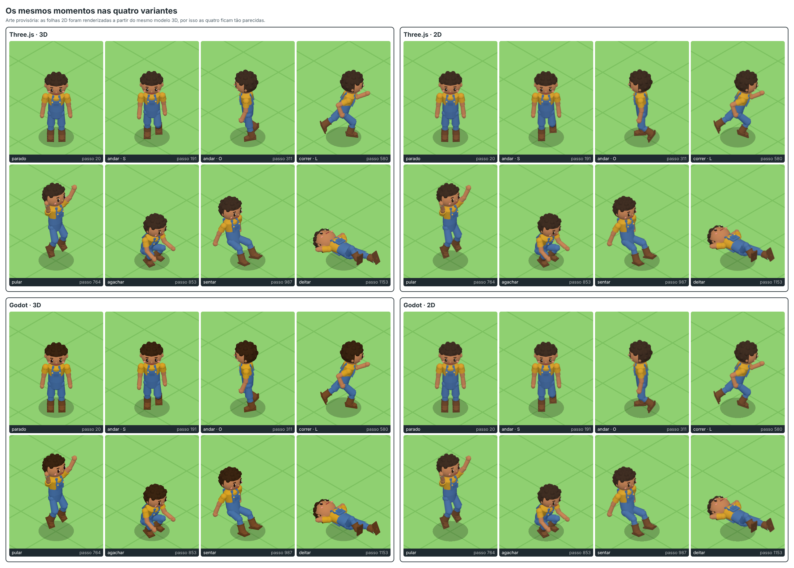

# Bancada de teste do personagem

Quatro demonstrações pequenas e jogáveis do mesmo personagem, para decidir com dados entre **2D (folhas de sprites, quadro a quadro)** e **3D em tempo real (GLB com esqueleto)**, e entre **Three.js** e **Godot 4**:

| | 3D (GLB) | 2D (sprites) |
|---|---|---|
| **Three.js** | `threejs/` com `?modo=3d` | `threejs/` com `?modo=2d` |
| **Godot 4** | `godot/` com `?modo=3d` | `godot/` com `?modo=2d` |

As quatro fazem a mesma coisa: câmera isométrica fixa (giro de 45°, inclinação de ~35°, ortográfica), um pedaço de chão com grade, movimento em 8 direções e as sete animações do contrato de arte (`idle`, `walk`, `run`, `jump`, `crouch`, `sit`, `lie`). Cenário está fora do escopo.

> **A arte aqui é provisória.** Os arquivos de `assets/` foram gerados por script a partir do avatar feito em código (`tools/visual-refs`): o `personagem.glb` é esse avatar exportado, e as folhas de sprites são **fotos desse mesmo modelo 3D**. Por isso o 2D e o 3D ficam quase idênticos nas capturas — isso não diz nada sobre como a arte final vai ficar em cada rota. O que a bancada testa agora é o caminho técnico (importar, animar, espelhar, trocar cabelo, tamanho do download, tempo de carga). Quando a arte de verdade chegar, é trocar os arquivos e reconstruir.



## Como rodar

Requisitos: Node 20 ou mais novo. Para o lado Godot, o **Godot 4.7.2** (testado só com essa versão) e os modelos de exportação ("export templates") da mesma versão instalados na pasta de dados do Godot (no Linux, `~/.local/share/godot/export_templates/4.7.2.stable/`; basta o `web_nothreads_release.zip`).

```bash
cd prototypes/character-test
npm install

# Three.js -> threejs/dist
node threejs/build.mjs

# Godot (Web, sem threads) -> godot/build/web
GODOT=/caminho/para/Godot_v4.7.2-stable_linux.x86_64 node tools/build-godot.mjs

# servir (cada comando fica rodando; Ctrl+C para parar)
node tools/servir.mjs threejs/dist 8081        # http://localhost:8081/
node tools/servir.mjs godot/build/web 8082     # http://localhost:8082/
```

Para abrir no celular, na mesma rede Wi-Fi: acrescente `--rede` ao comando de servir e use o endereço que ele mostra. Nenhum dos dois builds precisa de cabeçalhos especiais no servidor (o Godot foi exportado sem threads).

Endereços (valem para as duas portas):

| Endereço | O que abre |
|---|---|
| `/?modo=3d` | rota 3D (padrão) |
| `/?modo=2d` | rota 2D |
| `/?modo=2d&demo=1` | roteiro fixo de demonstração: anda nas 8 direções, corre, pula, agacha, senta, deita |
| `&visual=N` | começa com o visual N (3D: 0–5 = cabelo A/B/C, depois os mesmos com barba; 2D: 0 = A, 1 = B) |
| `&ui=0` | esconde os controles de toque e os botões; `&hud=0` esconde tudo |
| `/#modo-2d`, `/#modo-3d` | só no Three.js: o modo também pode vir depois do `#`, para páginas embutidas que não aceitam `?` |

Controles: **WASD ou setas** andam, **Shift** corre, **Espaço** pula, **C** agacha, **X** senta, **Z** deita; qualquer tecla de movimento levanta. No toque: alavanca à esquerda e botões à direita ("Correr" liga e desliga). No alto da tela: **Ver em 2D/3D**, **Trocar visual** (o teste de personalização) e **Demonstração**. No Three.js, **Ver em 2D/3D** troca na própria página, sem recarregar (encerra o modo atual e libera o contexto WebGL antes de iniciar o outro); no Godot, troca de cena, também sem recarregar.

O projeto Godot também abre no editor (`godot/project.godot`), mas rode `node tools/sync.mjs` antes: ele copia `assets/` e `config/` para dentro do projeto (essas cópias não vão para o git). No computador as opções vão depois de `--`: `godot --path godot -- --modo=2d --demo`.

### Ferramentas

| Comando | O que faz |
|---|---|
| `node tools/verificar.mjs` | teste automático de teclado e toque nas quatro variantes (34 verificações em cada) |
| `node tools/capturar.mjs` | refaz tudo em `capturas/` (`--sem-video` pula o vídeo, que demora) |
| `node tools/medir.mjs` | refaz `medidas.json` e a tabela deste README |
| `node tools/gerar-assets.mjs` | refaz a arte provisória (só se mexer no gerador; a saída é idêntica byte a byte a cada execução) |
| `node tools/glb-de-teste.mjs entrada.glb saida.glb` | gera um GLB de teste com textura e outros nomes de ossos e clipes (ver "O que foi verificado") |

As três primeiras usam o Playwright com Chromium já instalado na máquina; em outra máquina: `npm i -D playwright && npx playwright install chromium`. O vídeo precisa do `ffmpeg`.

## Pastas

```
prototypes/character-test/
  config/bench.json     comportamento comum às quatro variantes: velocidades, câmera, luz, chão,
                        tempos de mistura, roteiro da demonstração, nomes dos arquivos de arte
  assets/2d, assets/3d  pacotes de arte PROVISÓRIOS, no formato do contrato
  threejs/              app web: index.html, build.mjs, src/ (módulos ES; única dependência: three)
      src/sim.js        máquina de estados do personagem (passo fixo de 1/60 s)
      src/view3d.js + character3d.js   rota 3D        src/view2d.js + sprites.js   rota 2D
  godot/                projeto Godot 4 (GDScript, renderizador Compatibility)
      scripts/sim.gd    a mesma máquina de estados, traduzida linha a linha
      scripts/teste_3d.gd   rota 3D                   scripts/teste_2d.gd + sprites.gd   rota 2D
      shaders/cor_por_vertice.gdshader   ver "GLB com cor por vértice" mais abaixo
  tools/                gerador da arte provisória, build do Godot, servidor, captura, medição, teste
  capturas/             imagens e vídeo gerados pelas ferramentas
  medidas.json          números da última medição
```

Fora do git (ver `.gitignore`): `node_modules/`, `threejs/dist/`, `godot/build/`, `godot/.godot/`, e as cópias `godot/assets/` e `godot/config/`.

## Trocar pela arte final

1. Substitua os arquivos de `assets/3d/` (`personagem.glb`, `cabelo-b.glb`, `cabelo-c.glb`, `barba.glb`) e de `assets/2d/` (`sprites/<animação>.png`, `sprites.json`, `variante-b/walk.png`), com os mesmos nomes.
2. Reconstrua: `node threejs/build.mjs` e `GODOT=... node tools/build-godot.mjs` (este já copia a arte para o projeto Godot e reimporta).
3. Confira: `node tools/verificar.mjs`, `node tools/capturar.mjs`, `node tools/medir.mjs`.

O que as demonstrações exigem da arte, e o que toleram:

- **Animações do GLB pelo nome** (`idle`, `walk`, …). Aceitam diferença de maiúsculas e prefixos como `Armature|walk`. Se faltar alguma, o personagem fica na pose anterior e sai um aviso no console.
- **Nenhum nome de osso é fixo, a não ser o da cabeça**, que é detectado sozinho (procura "head" ou "cabeca" no nome, sem diferenciar maiúsculas; se não achar, usa o osso mais alto). Para forçar: `model.headBone` no `bench.json`.
- **Cabelo e barba dentro do `personagem.glb`** são reconhecidos pelo nome da malha (`hair`/`cabelo`, `beard`/`barba`) ou, sem isso, por serem malhas sem esqueleto presas ao osso da cabeça. Para forçar: `model.hairMesh`, `model.beardMesh`.
- **Peças avulsas** (`cabelo-b.glb` etc.): podem vir na altura da cabeça do modelo em pé ou já relativas ao osso; a demonstração descobre sozinha (`model.pieceSpace`: `auto`, `model` ou `bone`).
- **`sprites.json`**: o leitor aceita os nomes de campo em inglês ou português e completa o que faltar com os valores do contrato (célula 256, apoio em 128/232, direções S, SE, L, NE, N, quadros e qps por animação).
- **Escala do 2D**: `sprites.pixelsPerUnit` (hoje 138, que faz o personagem de ~200 px ter o mesmo tamanho do modelo de 1,6 unidade).

## Capturas

| Arquivo | O que mostra |
|---|---|
| `capturas/comparacao-2x2.png` | 8 momentos do roteiro, lado a lado nas quatro variantes |
| `capturas/comparacao-2x2.webm` e `.gif` | o roteiro inteiro (21 s) nas quatro variantes |
| `capturas/folha-three-3d.png`, `folha-three-2d.png`, `folha-godot-3d.png`, `folha-godot-2d.png` | folha de contato do roteiro: 27 momentos por variante |
| `capturas/personalizacao.png` | o teste de troca de visual nas quatro variantes |
| `capturas/telas-2x2.png`, `telas-celular.png` | a tela inteira com os controles, deitada e em formato de celular |

Nas capturas as quatro variantes rodam em modo "passo": a ferramenta manda avançar N passos da simulação e fotografa, então cada imagem é exatamente o mesmo instante em todas. A ferramenta confere isso (mesma animação, direção, posição e tempo de animação) antes de montar as folhas.

## Medidas

<!-- medidas:inicio -->
| | Three.js · 3D | Three.js · 2D | Godot · 3D | Godot · 2D |
|---|---:|---:|---:|---:|
| **Download para começar** (bruto / gzip / brotli) | **919 KB / 222 KB / 175 KB** | **1,58 MB / 1,13 MB / 1,10 MB** | **39,25 MB / 11,02 MB / 7,91 MB** | **39,25 MB / 11,02 MB / 7,91 MB** |
| — motor e código | 647 KB / 168 KB / 140 KB | 600 KB / 154 KB / 128 KB | 37,99 MB / 9,77 MB / 6,66 MB | 37,99 MB / 9,77 MB / 6,66 MB |
| — arte e dados | 273 KB / 54 KB / 35 KB | 1,00 MB / 999 KB / 994 KB | 1,26 MB / 1,25 MB / 1,24 MB | 1,26 MB / 1,25 MB / 1,24 MB |
| — arquivos buscados | 7 | 14 | 7 | 7 |
| Godot: `.pck` se só esta rota fosse publicada | — | — | 174 KB / 162 KB / 159 KB | 1,15 MB / 1,14 MB / 1,13 MB |
| **Primeiro quadro** (mediana de 5; mín–máx) | **260 ms** (228–320) | **155 ms** (146–169) | **1205 ms** (1179–1650) | **1126 ms** (1019–1173) |
| Chamadas de desenho por quadro (só a cena) | 6 | 5 | 6 | 5 |
| Triângulos por quadro (só a cena) | 3.176 | 76 | 3.204 | 74 |
| — com a interface do próprio motor | interface em HTML (fora da conta) | interface em HTML (fora da conta) | 37 chamadas, 7.068 triângulos | 36 chamadas, 3.926 triângulos |
| Memória de textura das folhas (RGBA sem compressão) | sem texturas; malhas: 141 KB | 50,00 MB (7 folhas); 60,00 MB com a variante B | sem texturas | 50,00 MB (7 folhas); 60,00 MB com a variante B |

Medido em 2026-11-11 · Chromium 153.0.8010.12 sem tela · WebGL: ANGLE (Google, Vulkan 1.3.0 (SwiftShader Device (Subzero) (0x0000C0DE)), SwiftShader driver) · Intel(R) Xeon(R) Processor @ 2.30GHz × 4 · Three.js 0.187.0 · Godot 4.7.2.stable.official.ed1daf0bf · tela 800x450 @1x.

<details><summary>Arquivos buscados por variante</summary>

**Three.js · 3D**

| arquivo | grupo | bruto | gzip | brotli |
|---|---|---:|---:|---:|
| `index.html` | motor | 3,6 KB | 1,3 KB | 1,1 KB |
| `main.js` | motor | 13 KB | 5,3 KB | 4,9 KB |
| `pedaco-chunk-BSLO6YE6.js` | motor | 0,7 KB | 0,3 KB | 0,3 KB |
| `pedaco-chunk-R4LMTHW6.js` | motor | 0,2 KB | 0,2 KB | 0,1 KB |
| `pedaco-view3d-CVPPN4PT.js` | motor | 53 KB | 17 KB | 15 KB |
| `pedaco-chunk-RT5PCAVZ.js` | motor | 577 KB | 144 KB | 119 KB |
| `assets/3d/personagem.glb` | arte | 273 KB | 54 KB | 35 KB |

**Three.js · 2D**

| arquivo | grupo | bruto | gzip | brotli |
|---|---|---:|---:|---:|
| `index.html` | motor | 3,6 KB | 1,3 KB | 1,1 KB |
| `main.js` | motor | 13 KB | 5,3 KB | 4,9 KB |
| `pedaco-chunk-BSLO6YE6.js` | motor | 0,7 KB | 0,3 KB | 0,3 KB |
| `pedaco-chunk-R4LMTHW6.js` | motor | 0,2 KB | 0,2 KB | 0,1 KB |
| `pedaco-view2d-DN2G62ZQ.js` | motor | 5,9 KB | 2,8 KB | 2,6 KB |
| `pedaco-chunk-RT5PCAVZ.js` | motor | 577 KB | 144 KB | 119 KB |
| `assets/2d/sprites.json` | arte | 1,1 KB | 0,4 KB | 0,3 KB |
| `assets/2d/sprites/idle.png` | arte | 71 KB | 69 KB | 69 KB |
| `assets/2d/sprites/walk.png` | arte | 202 KB | 196 KB | 195 KB |
| `assets/2d/sprites/run.png` | arte | 185 KB | 180 KB | 179 KB |
| `assets/2d/sprites/jump.png` | arte | 173 KB | 171 KB | 170 KB |
| `assets/2d/sprites/crouch.png` | arte | 111 KB | 109 KB | 108 KB |
| `assets/2d/sprites/sit.png` | arte | 110 KB | 107 KB | 107 KB |
| `assets/2d/sprites/lie.png` | arte | 169 KB | 167 KB | 166 KB |

**Godot · 3D**

| arquivo | grupo | bruto | gzip | brotli |
|---|---|---:|---:|---:|
| `index.html` | motor | 5,3 KB | 2,1 KB | 1,7 KB |
| `index.png` | motor | 21 KB | 19 KB | 19 KB |
| `index.js` | motor | 273 KB | 67 KB | 58 KB |
| `index.wasm` | motor | 37,68 MB | 9,68 MB | 6,58 MB |
| `index.pck` | arte | 1,26 MB | 1,25 MB | 1,24 MB |
| `index.audio.position.worklet.js` | motor | 2,9 KB | 1,1 KB | 0,9 KB |
| `index.audio.worklet.js` | motor | 7,1 KB | 2,1 KB | 1,8 KB |

**Godot · 2D**

| arquivo | grupo | bruto | gzip | brotli |
|---|---|---:|---:|---:|
| `index.html` | motor | 5,3 KB | 2,1 KB | 1,7 KB |
| `index.png` | motor | 21 KB | 19 KB | 19 KB |
| `index.js` | motor | 273 KB | 67 KB | 58 KB |
| `index.wasm` | motor | 37,68 MB | 9,68 MB | 6,58 MB |
| `index.pck` | arte | 1,26 MB | 1,25 MB | 1,24 MB |
| `index.audio.position.worklet.js` | motor | 2,9 KB | 1,1 KB | 0,9 KB |
| `index.audio.worklet.js` | motor | 7,1 KB | 2,1 KB | 1,8 KB |

</details>
<!-- medidas:fim -->

Como ler:

- **Os tempos NÃO são desempenho de celular.** Foram medidos num servidor, sem placa de vídeo (WebGL desenhado por software), com os arquivos vindos da própria máquina, sem rede e sem compressão. Servem para comparar as variantes entre si; no celular entram a rede, o processador e a placa de vídeo de verdade. Quadros por segundo não foram medidos, porque com desenho por software o número não significaria nada.
- **Download** é tudo o que o navegador busca até o jogo começar. As colunas gzip e brotli são o tamanho se o servidor comprimir os arquivos (qualquer hospedagem séria comprime). Só para dar ordem de grandeza, numa conexão de 10 Mbit/s o total com brotli levaria perto de 0,15 s (Three.js 3D), 0,9 s (Three.js 2D) e 6,6 s (Godot) — conta de padaria, não medição.
- **No Godot, as duas rotas baixam o mesmo pacote** (`index.pck`), que leva a arte das duas. A linha "`.pck` se só esta rota fosse publicada" mostra o tamanho que cada rota teria sozinha. O peso fixo do Godot é o motor (`index.wasm`): 37,7 MB, 6,6 MB com brotli, qualquer que seja o jogo.
- **Memória de textura**: cada folha vira uma textura RGBA sem compressão na placa de vídeo. São 200 células de 256×256 (40 quadros × 5 direções) = 50 MB para um único visual do personagem; cada folha extra de 8 quadros soma 10 MB. No 3D o modelo inteiro ocupa 141 KB.
- **As folhas provisórias são mais leves do que a arte final deve ser**: foram reduzidas a 256 cores e têm sombreado chapado, que comprime bem. Folhas pintadas, em cores cheias, tendem a pesar algumas vezes mais no download (a memória de textura não muda).

## Comparação honesta

O que foi fácil e o que deu trabalho em cada combinação. "Linhas" é o tamanho do código da rota, para dar ideia de esforço.

### Importar o GLB (rota 3D)

- **Three.js** — sem surpresas. `GLTFLoader` carrega o arquivo em tempo de execução; malha com esqueleto, cores por vértice (ou textura) e os sete clipes saíram certos de primeira. O pedaço de código da rota 3D, com o carregador, pesa ~15 KB (brotli). `character3d.js`: 182 linhas, a maior parte para achar clipes, cabeça e cabelo sem depender de nomes.
- **Godot** — o GLB vira uma cena na importação do editor (por isso o build precisa do Godot instalado e de um passo de importação). Clipes, esqueleto e a malha de cabelo presa ao osso (virou `BoneAttachment3D` sozinha) vieram certos. Três coisas pediram ajuste:
  1. **GLB com cor por vértice aparece errado.** O importador (4.7.2) traz as cores, mas o material importado não as usa: o personagem apareceu **todo branco**. Ligando a opção do material, ele apareceu **escuro e saturado demais**, porque no renderizador Compatibility a cor por vértice é tratada como sRGB e o glTF a guarda em linear. Resolvido com um shader de 22 linhas (`godot/shaders/cor_por_vertice.gdshader`) aplicado só a malhas sem textura. Sobra uma diferença pequena nos tons mais escuros (o cabelo fica um pouco mais avermelhado que no Three.js), porque o Godot guarda a cor por vértice em 8 bits. **Um modelo com textura não passa por nada disso**: testado com um GLB de teste (corpo e cabelo com uma textura de paleta), que apareceu certo no Godot sem nenhum ajuste. Nesse caso o Godot extrai a textura embutida para um PNG ao lado do GLB, dentro do projeto; ao trocar esse GLB por outro, a reimportação imprimiu uma vez o erro "Unrecognized UID", e o build saiu certo mesmo assim.
  2. **Repetição das animações**: o glTF não diz quais clipes repetem; o Godot importa todos sem repetição. A demonstração define isso pelo `bench.json`.
  3. Para as quatro variantes ficarem no mesmo instante, o `AnimationPlayer` é avançado à mão (`advance(dt)`), e foi preciso um `advance(0)` logo depois de `play()`, senão a animação nova começa um quadro atrasada.
  
  `teste_3d.gd`: 381 linhas (inclui montar câmera, luz e chão em código).

### Importar as folhas de sprites (rota 2D)

- **Three.js** — não existe importador: a folha é uma textura e o quadro é escolhido deslocando as coordenadas de textura. É pouco código (`view2d.js` 116 linhas + `sprites.js` 67), mas é tudo por conta própria. Dois cuidados que custaram tempo: desligar a correção de cor do Three.js nessa rota, senão as cores da folha saem alteradas, e usar alfa pré-multiplicado para não aparecer contorno escuro quando o sprite é ampliado.
- **Godot** — `SpriteFrames` + `AnimatedSprite2D` fazem o trabalho, mas o editor só recorta a grade à mão; para seguir o `sprites.json` a demonstração monta o `SpriteFrames` por script ao abrir (`teste_2d.gd` 212 linhas + `sprites.gd` 122). Dois achados:
  1. **A importação padrão de textura inflou o pacote 2,4 vezes** (2,79 MB contra 1,15 MB): a opção "fix alpha border" preenche os pixels transparentes e estraga a compressão. Resolvido nas opções de importação do projeto (alfa pré-multiplicado, sem "fix alpha border") — com isso as folhas dentro do pacote do Godot ficaram até um pouco menores que os PNG originais. Essas opções valem para **todas** as texturas do projeto, inclusive as extraídas de um GLB: para textura opaca não muda nada, mas uma textura de modelo com transparência precisaria de ajuste próprio.
  2. É preciso ligar `filter_clip` em cada recorte, senão a célula vizinha vaza na borda do sprite.

### Mistura entre animações

- **3D, nos dois motores** — funciona e fica igual. Three.js: `crossFadeFrom` entre ações. Godot: `play(nome, tempo_de_mistura)`. Passar de andar para correr mantendo a fase da passada foi uma linha em cada um. Nas folhas de contato, os quadros "levantar" (passos 893 e 1201) mostram a mistura no meio do caminho, idêntica nos dois.
- **2D, nos dois motores** — não existe mistura: a troca de animação é um corte seco. Levantar de sentado ou deitado "pula" direto para a pose em pé (mesmos passos 893 e 1201 nas folhas 2D). Para ter transição no 2D, ela precisa ser desenhada como mais quadros.

### Espelhamento (SO, O, NO a partir de SE, L, NE)

- Trivial nos dois: repetição negativa da textura no Three.js, `flip_h` no Godot.
- O que o espelhamento custa é visual, não técnico: **troca esquerda e direita**. A perna da frente na passada sai trocada em relação ao 3D (compare "andar · SO", "andar · O" e "correr · O" nas folhas 2D e 3D), e qualquer detalhe assimétrico — o laço do cabelo C, um bolso, uma ferramenta na mão direita — muda de lado quando o personagem vira.

### Troca de cabelo e barba

- **3D, nos dois motores** — funciona: a peça é carregada e presa ao osso da cabeça, e acompanha todas as animações. O único cuidado foi o sistema de coordenadas da peça (o contrato não diz se ela vem na altura da cabeça ou relativa ao osso); as duas rotas resolvem sozinhas. ~20 linhas em cada motor. Cada peça pesa 3–4 KB (brotli).
- **2D, nos dois motores** — só dá para trocar a folha inteira. A variante B troca só o andar, como pede o contrato, então parado o personagem volta ao visual A. Um segundo visual completo são outras 200 células desenhadas (e mais 50 MB de textura); combinações (3 cabelos × barba × roupas) multiplicam isso, a não ser que os sprites sejam feitos em camadas, o que o contrato atual não prevê.

### Build e tamanho

- **Three.js** — `esbuild` monta tudo em menos de 1 s; cada modo é um pedaço carregado sob demanda (o 2D não baixa o código nem o arquivo do 3D, e vice-versa). Código total: 127 KB (2D) a 140 KB (3D) com brotli.
- **Godot** — precisa do editor (146 MB) e dos modelos de exportação; o build completo (importar + exportar) leva ~15 s. O motor exportado pesa 6,6 MB com brotli e leva ~1 s para iniciar mesmo vindo da própria máquina. Em troca, a interface, a entrada por toque e o editor de cenas já vêm prontos (aqui tudo foi montado por código de propósito, para as duas implementações ficarem comparáveis).
- A interface do Godot é desenhada pelo motor (31 chamadas de desenho a mais, do jeito simples como foi feita aqui); no Three.js é HTML por cima da tela.

## Achados sobre o contrato de arte

Coisas que apareceram ao gerar a arte provisória no formato do contrato e que vale resolver antes de encomendar a arte final:

1. **Deitado e sentado não cabem na célula com o ponto de apoio em y = 232.** Só sobram 24 px abaixo do apoio, e um corpo deitado com os pés para a câmera ocupa mais que isso. Na arte provisória, os quadros finais de `lie` foram deslocados para cima (29 px na linha S, 25 na N, 15 na NE, 9 na SE) e um quadro de `sit` na NE, 4 px. Resultado: no 2D o personagem deitado aparece um pouco fora do lugar em relação ao 3D. Saídas possíveis: permitir um ponto de apoio próprio por animação no `sprites.json`, ou uma célula maior para `lie`.
2. **O pulo tem teto baixo**: com o personagem de ~200 px e o apoio em 232, sobram ~33 px acima da cabeça. O pulo provisório foi limitado a isso (62% da altura original). Um pulo mais alto pede célula mais alta ou o corpo subindo por código em vez de no desenho.
3. **Corrida**: a passada precisou ser encurtada 15% para o pé de trás não sair 1–2 px da célula nas linhas N e NE.
4. **O contrato não define os nomes dos campos do `sprites.json`** nem **o sistema de coordenadas das peças avulsas** (`cabelo-b.glb` etc.). As demonstrações toleram as variações mais prováveis, mas é melhor fixar isso no pedido.
5. **Cor por vértice ou textura**: o contrato aceita as duas. Para o Godot, textura dá menos trabalho (ver acima).

## O que foi verificado, e o que não foi

Verificado nesta máquina (Chromium sem tela, WebGL por software):

- As sete animações aparecem nas quatro variantes: conferido olhando as quatro folhas de contato.
- Troca de cabelo A/B/C e barba no 3D e troca para a folha B no 2D, nos dois motores: conferido em `capturas/personalizacao.png`.
- Teclado e toque (alavanca, botões, dois dedos ao mesmo tempo, troca de modo, troca de visual, demonstração): `node tools/verificar.mjs`, 34 verificações por variante, todas passando. As velocidades medidas são idênticas nas quatro (1,3 e 3,0 unidades por segundo).
- O roteiro de demonstração é determinístico e fica sincronizado entre as quatro.
- O build Web do Godot roda sem threads e sem cabeçalhos especiais no servidor.
- **Troca de arte = trocar arquivo e reconstruir**: numa cópia limpa do projeto (só os arquivos que vão para o git, `npm ci`, os dois builds), o `personagem.glb` foi trocado por um GLB de teste feito por `tools/glb-de-teste.mjs` — textura no lugar de cor por vértice, ossos chamados `mixamorig:Head` etc., clipes chamados `Armature|Walk` etc., malha de cabelo chamada `Hair`. As sete animações, a detecção da cabeça e a troca de cabelo e barba funcionaram nos dois motores sem mexer em código nem em configuração.

Não verificado:

- **Desempenho em celular de verdade** (nem em qualquer placa de vídeo de verdade).
- **Toque em aparelho de verdade**: o teste usa eventos de toque simulados no Chromium. Safari/iOS não foi testado.
- O projeto Godot rodando fora do navegador com janela (só foi importado e executado sem tela, sem desenhar).
- GLB com mais de uma malha de corpo, com várias texturas ou com textura transparente; esqueleto sem nenhum osso com "head" no nome (cai no "osso mais alto", que não foi exercitado); arquivo de arte fora do contrato (clipe faltando, folha com outro tamanho de célula) — o código trata esses casos com avisos, mas eles não foram testados.
- Outras versões do Godot além da 4.7.2.
