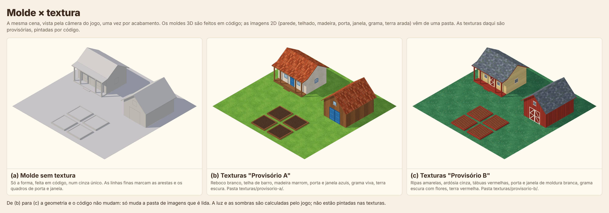

# Molde × textura

Demonstração técnica de um caminho de arte para as construções do jogo. A forma de cada construção é um **molde 3D feito em código**, sem cor e sem textura. O acabamento vem de **imagens 2D feitas à parte** (parede, telhado, madeira, porta, janela, grama, terra arada), que o jogo aplica sobre o molde. Nada mais no projeto depende desta pasta.



A imagem mostra a mesma cena três vezes, vista pela câmera do jogo: (a) o molde puro, em cinza; (b) o conjunto de texturas `provisorio-a`; (c) o conjunto `provisorio-b`. De (b) para (c) a geometria e o código não mudam. Só muda a pasta de imagens que é lida.

> **As texturas daqui são provisórias.** Foram pintadas por código, só para provar o caminho de ponta a ponta. As de verdade virão de um gerador de imagens, no estilo que for aprovado. O rascunho desse pedido está em [`arte/texturas/construcoes/pedido.md`](../../arte/texturas/construcoes/pedido.md).

## Como rodar

Requisitos: Node 20 ou mais novo e o Playwright com Chromium já instalado na máquina (os scripts não instalam o navegador).

```bash
cd prototypes/molde-textura
npm install
npm run tudo
```

`npm run tudo` refaz, nesta ordem, as texturas provisórias (`texturas/`), os moldes exportados (`moldes/*.glb`), todas as imagens de `capturas/` e as medidas (`medidas.json` e a tabela deste README). Leva cerca de um minuto.

| Comando | O que faz |
|---|---|
| `npm run texturas` | Refaz só as texturas provisórias e a de teste de UV. |
| `npm run moldes` | Refaz só os arquivos `.glb`. |
| `npm run capturas` | Refaz só as imagens de `capturas/`, com os conjuntos que estiverem em `texturas/`. |
| `npm run medir` | Refaz `medidas.json` e a tabela de medidas deste README. |
| `npm run verificar` | Roda as conferências automáticas descritas no fim deste README. |

## O que há em `capturas/`

| Arquivo | O que mostra |
|---|---|
| `molde-x-textura.png` | A comparação lado a lado: molde puro, conjunto A, conjunto B. |
| `estado-molde.png`, `estado-provisorio-a.png`, `estado-provisorio-b.png` | Cada estado sozinho, em resolução maior (2400 × 1560). |
| `molde-uv.png` | Os moldes com um xadrez numerado, de frente e de trás, para julgar a direção e a densidade do UV. |
| `texturas-2x2.png` | As imagens 2D de cada conjunto. As que repetem aparecem em ladrilho 2 × 2, para mostrar a emenda. |

## Como funciona

- **Moldes** (`src/moldes/`). São quatro: `casa`, `celeiro`, `canteiro` e `chao` (o quadrado de chão que fica por baixo de tudo). Cada um é uma lista de faces planas com posição, normal e UV. Não há cor por vértice.
- **Slots.** Cada face pertence a um destes sete slots de material: `parede`, `telhado`, `madeira`, `porta`, `janela`, `grama`, `terra-arada`. O molde só diz o slot; ele não sabe que imagem vai receber.
- **Slots que repetem** (`parede`, `telhado`, `madeira`, `grama`, `terra-arada`). O UV é medido em unidades de mundo: uma repetição da imagem cobre 2 × 2 unidades em qualquer face de qualquer molde. Esse número está em `config/molde.json`. A telha desce a água do telhado, a tábua fica em pé nas paredes e acompanha o comprimento em vigas e tábuas deitadas.
- **Porta e janela.** São imagens únicas, cada uma no seu próprio quadro (UV de 0 a 1), colocado 0,02 unidade à frente da parede. A imagem da porta tem proporção 1:2 e a da janela 1:1. A porta dupla do celeiro usa a mesma imagem duas vezes; a folha da direita é espelhada.
- **Conjunto de texturas.** É uma pasta em `texturas/` com um PNG por slot e um `texturas.json`. O arquivo diz, para cada slot, o nome da imagem, se ela repete e quantas unidades de mundo uma repetição cobre (`tamanhoNoMundo`). A grama dos conjuntos provisórios usa 4 unidades em vez de 2, porque num gramado grande a repetição aparecia; isso foi mudado só no `texturas.json`.
- **Luz e sombra.** São calculadas pelo jogo na hora (um sol com sombra suave e uma luz de céu). As texturas não têm sombra nem perspectiva pintadas.
- **Moldes exportados** (`moldes/*.glb`). Cada arquivo traz a geometria, o UV e os slots como materiais com nome, sem nenhuma textura dentro, para abrir o mesmo molde em outras ferramentas. No `.glb` o V do UV segue a convenção do formato (origem no alto da imagem).

## Como acrescentar um terceiro conjunto

1. Copie a pasta `texturas/provisorio-a` com outro nome, por exemplo `texturas/estilo-aprovado`.
2. Troque os sete PNG pelos novos, mantendo os nomes dos arquivos. As imagens que repetem precisam ser quadradas e emendar sem marca; a porta precisa ter proporção 1:2 e a janela 1:1.
3. No `texturas.json` da pasta nova, mude `nome` e `descricao`. Se uma imagem foi pintada para cobrir outro tamanho, ajuste o `tamanhoNoMundo` do slot.
4. Rode `npm run capturas`.

A comparação ganha um painel (d) e aparece `capturas/estado-estilo-aprovado.png`. Nenhum código muda. Para tirar um conjunto da comparação, apague a pasta dele.

## Medidas

Triângulos e chamadas de desenho foram contados pelo renderizador, com cada molde sozinho em cena. A coluna "com a passada de sombra" soma as chamadas que o sol faz para desenhar a sombra. A memória de vídeo é uma conta (RGBA de 8 bits sem compressão, com mipmaps), não uma medição.

<!-- medidas:inicio -->
| Molde | Triângulos | Vértices | Slots usados | Chamadas de desenho | Com a passada de sombra | Arquivo `.glb` |
|---|---:|---:|---|---:|---:|---:|
| `casa` | 104 | 206 | parede, telhado, madeira, porta, janela | 5 | 8 | 9,9 KB |
| `celeiro` | 36 | 70 | telhado, madeira, porta, janela | 4 | 6 | 4,9 KB |
| `canteiro` | 34 | 68 | madeira, terra-arada | 2 | 4 | 3,9 KB |
| `chao` | 2 | 4 | grama | 1 | 2 | 1,3 KB |

| Conjunto de texturas | Tamanho em disco (7 PNG) | Memória de vídeo estimada |
|---|---:|---:|
| `texturas/provisorio-a/` | 797,4 KB | 10,7 MB |
| `texturas/provisorio-b/` | 667,3 KB | 10,7 MB |
| `texturas/teste-uv/` | 37,6 KB | 10,7 MB |
<!-- medidas:fim -->

Cada slot usado custa uma chamada de desenho por construção. Numa cena cheia, o normal é juntar as malhas por slot, o que leva a conta para uma chamada por slot no cenário inteiro; isso não foi testado aqui.

## Para que a técnica serve e para que não serve

Serve bem para:

- Construções e objetos feitos de faces planas: casas, celeiros, cercas, canteiros, caixotes, caminhos e o próprio chão.
- Trocar o estilo sem refazer modelos. A mesma casa virou reboco branco com telha de barro e depois ripa amarela com ardósia, só trocando a pasta de imagens.
- Manter a escala coerente. A mesma imagem de parede serve a todas as construções, com a mesma densidade em todas as faces.
- Deixar a luz por conta do jogo. Hora do dia e sombras continuam funcionando, porque nada disso está pintado na textura.
- Variações de uma mesma construção, como níveis de melhoria ou cores escolhidas pelo jogador.

Não serve, ou serve mal, para:

- **Formas curvas ou orgânicas**: árvores, arbustos, pedras, plantações. Elas não têm faces planas onde repetir uma imagem. Precisariam de um UV próprio e de uma textura pintada para aquele modelo específico, o que um gerador de imagens não faz de forma confiável.
- **Personagens e animais.** Além do UV próprio, eles dobram e se mexem. Continuam no caminho do personagem (`prototypes/character-test`).
- **Relevo em porta e janela.** Elas são imagens chapadas num quadro: não têm profundidade, batente saliente nem vidro recuado. De longe, pela câmera do jogo, funciona; de perto parece um adesivo.
- **Detalhes que precisam casar com a geometria.** A imagem é cortada onde a face acaba: uma fiada de telhas pode terminar pela metade na cumeeira, e as tábuas não dobram a esquina. Peças finas, como os postes, recebem uma tira qualquer da imagem de madeira.
- **Superfícies grandes.** A repetição aparece, como aconteceu com a grama a cada 2 unidades. Aumentar o `tamanhoNoMundo` ajuda, mas não resolve em áreas muito grandes.

## O que foi conferido e o que não foi

Conferido nesta máquina, com WebGL por software:

- Todas as imagens de `capturas/` foram abertas e olhadas, inteiras e em recortes ampliados: texturas na posição certa, telhas descendo a água, tábuas em pé, sem imagem esticada e sem borda escura em volta de porta e janela.
- A direção e a densidade do UV foram conferidas em `molde-uv.png`, de frente e de trás. Os números aparecem em pé e legíveis em todas as faces; a única imagem espelhada é a folha direita da porta dupla, de propósito.
- As emendas foram olhadas em ladrilho 2 × 2, em tamanho real, nas dez texturas que repetem. O gerador também mede cada emenda e para com erro se ela se destacar.
- Não apareceu sobreposição piscando entre os quadros de porta e janela e as paredes, em imagens paradas tiradas de seis posições de câmera.
- `npm run verificar` passou: as texturas e os `.glb` saem idênticos, byte a byte, ao serem gerados de novo; a silhueta da cena é a mesma, pixel a pixel, nos três estados (mesmo enquadramento); a cena montada a partir dos `.glb` fica igual à montada direto do código (diferença máxima de 1 em 255).
- Os quatro `.glb` passaram pelo validador de glTF da Khronos sem erros nem avisos.
- Numa cópia limpa da pasta, só com o código, `npm install` e `npm run tudo` refizeram tudo. Uma terceira pasta de texturas, sem mexer em código, entrou na comparação como painel (d).

Não conferido:

- **Texturas de um gerador de imagens.** Emenda perfeita e transparência de verdade são fáceis por código e difíceis para um gerador. É provável que as imagens geradas precisem de um passo de correção antes de entrar aqui.
- **Placa de vídeo de verdade e celular.** Tudo foi renderizado por software, em imagem parada. Não foi visto em movimento, onde costumam aparecer cintilação em padrões finos e sobreposição piscando.
- **Outras ferramentas.** Os `.glb` foram lidos de volta só pelo three.js e pelo validador. Não foram abertos no Blender nem no Godot.
- **Desempenho numa cena cheia** e a junção das malhas por slot.
- **Bytes idênticos em outra máquina.** A repetição exata foi testada só aqui, com as versões fixadas no `package-lock.json`.
